# ECA docs site updates, phase 0

This work involved typography, legibility, icons, etc. Clojurists Together funded, Q3, 2026

Screenshots compare the last commit (before) with the working tree (after), both built with `mkdocs-material` 9.6 at 1440x900.

- [Documentation page typography](#documentation-page-typography)
- [Sidebars and table of contents](#sidebars-and-table-of-contents)
- [Homepage icons and feature cards](#homepage-icons-and-feature-cards)
- [Install page](#install-page)
- [Protocol page arrows](#protocol-page-arrows)
- [Misc](#misc)

 

## Documentation page typography

- Changed: Inter typeface as the site font, loaded through `theme.font`, plus Inter typeface `600` from Google Fonts for headings
- Changed: Article column capped at `700px`, body text `0.85rem` (`17px`), line height `1.7`
- Changed: Headings in `rem` so they no longer scale with body text: `h1` `36px`, `h2` `24px`, `h3` `20px`, all weight `600`, color `#333`, letter spacing `-0.025em`
- Changed: Body links use the text color at weight `600` with a gray underline set `0.25em` below the text, darkening on hover
- Changed: Hover and focus accent is black instead of accent (teal)
- Changed: Content tab labels keep their accent (teal) through a dedicated `--eca-teal` token

 

 

### Docs page

**Before**: Roboto typeface and accent (teal). 
**After**: Inter typeface and neutral. 
 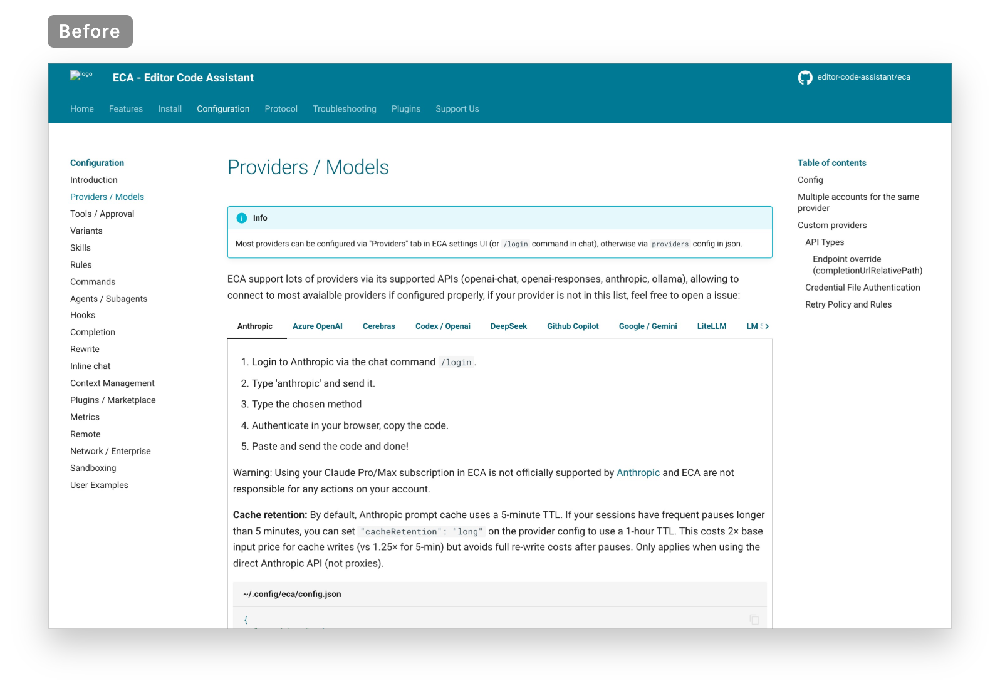

 

 

### Article

**Before**: Accent (teal) headings and links. 
**After**: Inter typeface and underlined links. 
 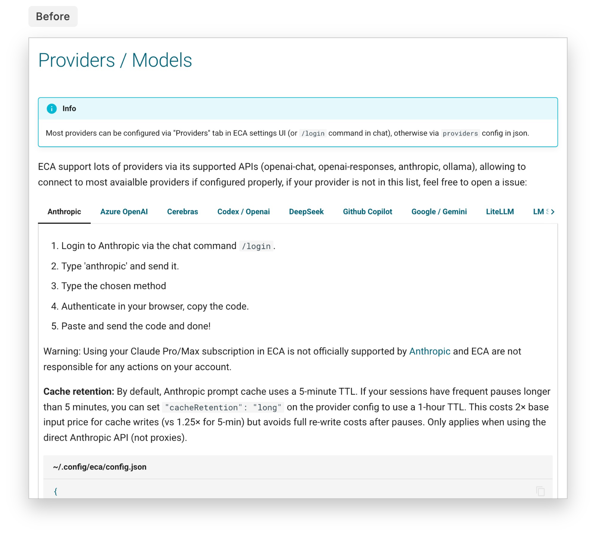

 

## Sidebars and table of contents

- Changed: Items indented `1.3em` with a faint left rule that lines up with the section heading
- Changed: About 20% more vertical space per item
- Changed: Active page bold with a dark segment on the rule, instead of accent (teal) text
- Changed: Top-level links weight `500`, nested links weight `400` at opacity `0.8`
- Changed: Section heading indented `0.9em`, dark gray instead of accent (teal), hover is black

 

 

### Sidebar

**Before**: Accent (teal) and flat. 
**After**: Indented with rule. 
 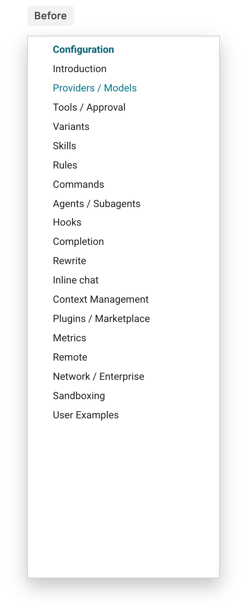

 

 

### Table of contents

**Before**: Accent (teal). 
**After**: Indented with rule. 
 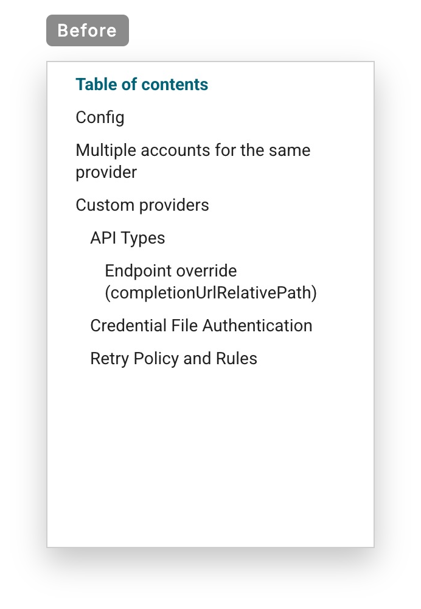

 

## Homepage icons and feature cards

- Changed: All emoji replaced with Lucide icons (`lucide-static` 1.57.0, ISC license) in `docs/overrides/.icons/lucide`, drawn at `stroke-width: 1.5`
- Changed: "Free & Open Source" uses the Lucide `git-fork` icon instead of the oversized green OSI logo
- Changed: Top three feature cards use the same icon-left, two-column layout as the cards below
- Changed: Card text one step tighter: line height `1.45` and `1.4`
- Changed: Homepage accent tokens (`--eca-brand-*`) neutral (grays and black) instead of accent (teal)

 

 

### "Why ECA?"

**Before**: Emoji icons. 
**After**: Lucide icons. 
 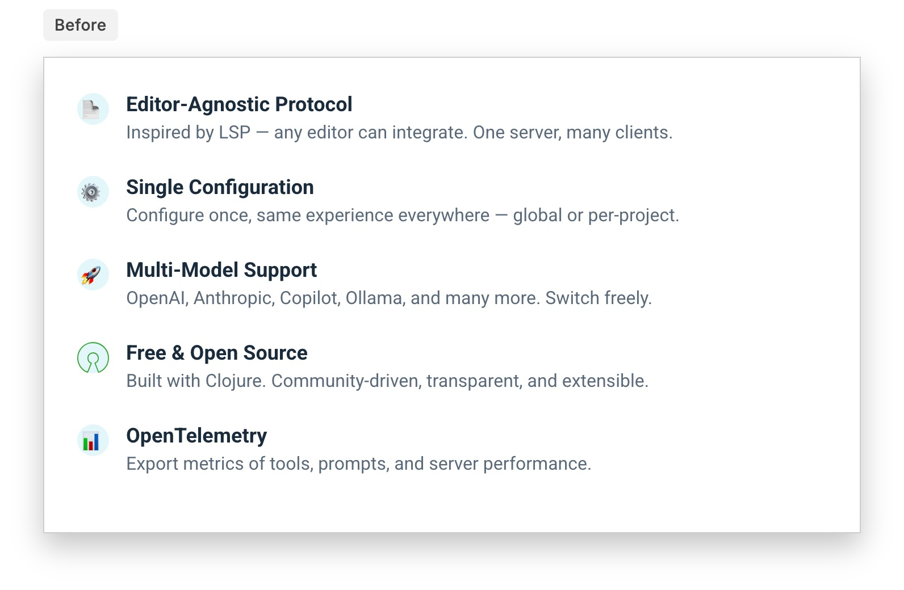

 

 

### Feature cards

**Before**: Emoji icons and stacked. 
**After**: Lucide icons and two columns. 
 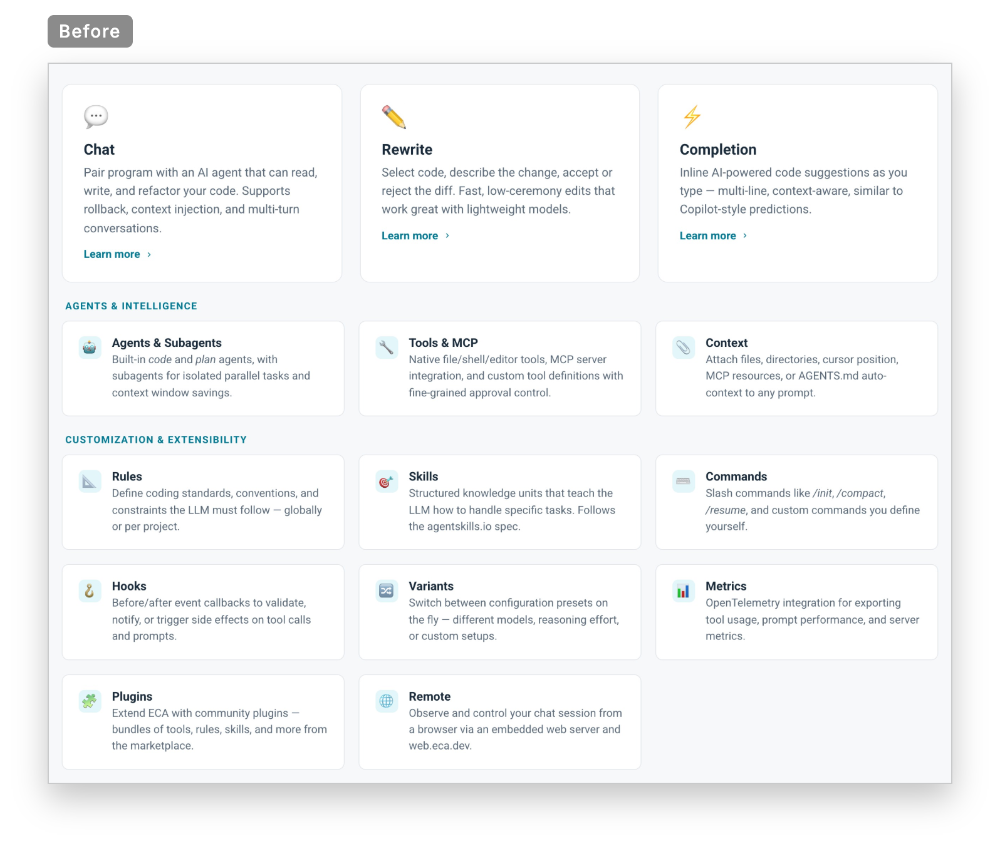

 

 

### Config tabs

**Before**: Emoji icons. 
**After**: Lucide icons. 
 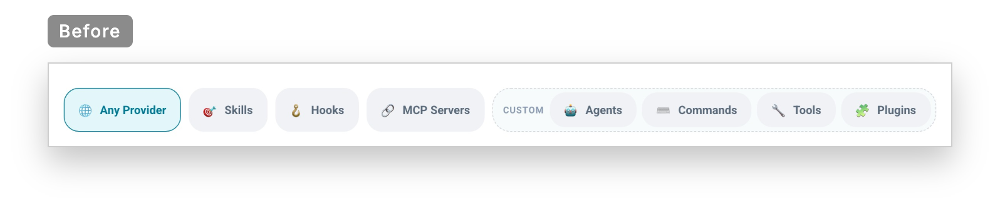

 

## Install page

- Changed: Intro, question, tabs, "Install the ECA server manually" section and "Something not working?" section share one `60rem` left edge
- Changed: "Auto install" callout full width with a Lucide `info` icon
- Changed: "Where do you want to use ECA?" matches the doc page `h1`
- Changed: Plugin copy split into two paragraphs, dash replaced with a period
- Changed: "Install the ECA server manually" section no longer a hidden toggle, always shown
- Changed: Editor tabs and manual install tabs share one underline style with accent (teal) labels
- Changed: "Something not working?" section is a bulleted list with the doc page link style

 

 

### Install page

**Before**: Centered intro. 
**After**: Left aligned. 
 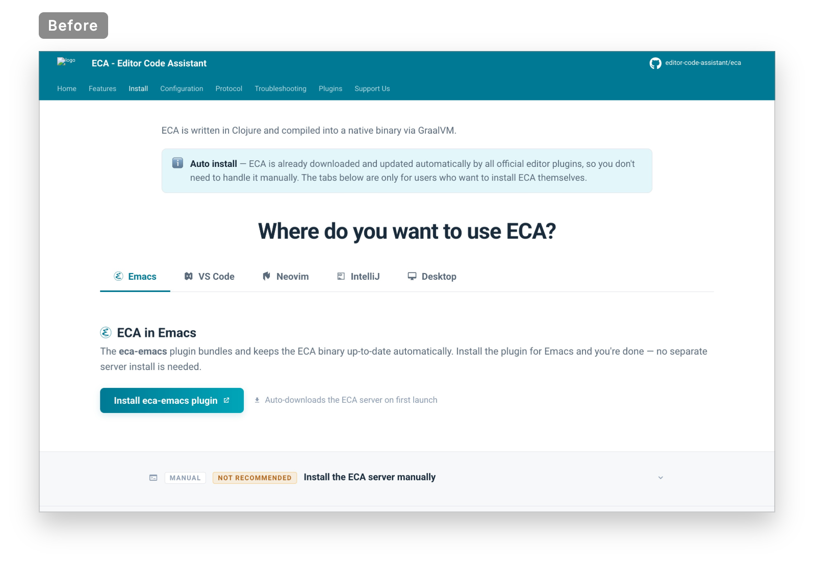

 

 

### Install intro

**Before**: Centered and narrow. 
**After**: Left aligned and full width. 
 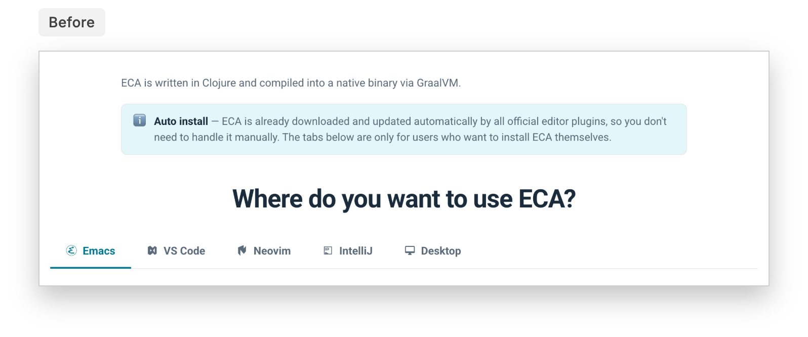

 

 

### Plugin copy

**Before**: One paragraph. 
**After**: Two paragraphs. 
 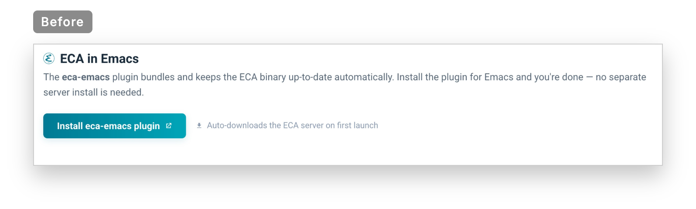

 

 

### Manual install

**Before**: Collapsed toggle click target is too distant, small, and faint: the user may miss it. 
**After**: The instructions are always open and visible. Reduced noise on the section heading. 
 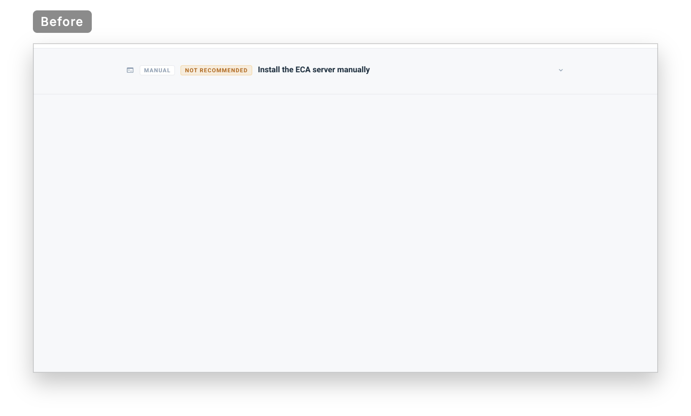

 

 

### Help

**Before**: Centered sentence. 
**After**: Bulleted list with aligned hyperlink styling. 
 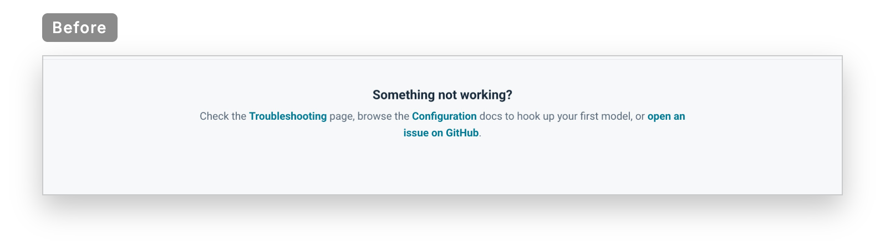

 

## Protocol page arrows

- Changed: Emoji arrows replaced with plain Unicode text arrows in 61 headings: → ← ↩ ↪

 

 

### Protocol headings

**Before**: Emoji arrows. 
**After**: Text arrows. 
 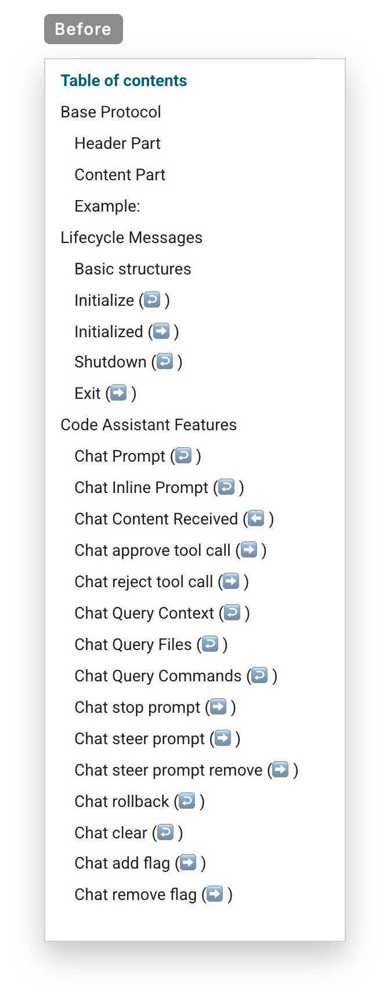

 

## Misc

Header, homepage hero and footer keep their original accent (teal).

- Added: `docs/evolution` excluded from the published site with `exclude_docs`
- Added: Notes on the Configuration sidebar structure in `docs/evolution/planning/sidebar-navigation.md`
